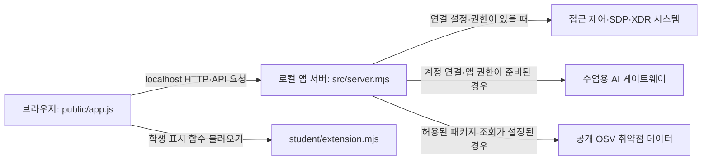

# 케셰브 학생 실행 설명서

이 문서는 2026-11-27에 확인한 `C:\Users\User\kesheb-defense` 작업본과 현재 저장소의 실행 파일을 기준으로 작성했습니다. 새 PowerShell에서 앱을 실행하는 절차, 제공 코드와 학생 코드의 경계, 현재 확인 범위를 정리합니다. 기존 문서는 유지합니다.

## 1. 목적과 기능

케셰브는 브라우저에서 본인 계정의 로그인·기기·세션 정보, 업무 앱 접근 판정, 최근 보안 기록, 알림·진단 정보, 앱 안 AI 연결·사건 설명·조치 상태, 설치 패키지의 OSV 조회 결과를 확인하도록 구성한 수업용 보안 Agent 프로젝트입니다. 화면에서 볼 수 있는 실제 자료는 로컬 앱 서버와 연결된 제공 시스템의 응답 및 실행 모드에 따라 달라집니다.

기본 실행은 로컬 앱 서버의 응답을 확인하는 과정입니다. 이 응답만으로 접근 제어·XDR 서버, AI 게이트웨이 또는 업무 앱에 실제 연결됐다고 판단하지 않습니다. `--demo` 실행 자료는 예제 데이터이며 현재 계정의 결과가 아닙니다.

## 2. 확인한 환경과 프로젝트 구조

| 항목 | 확인 내용 |
|---|---|
| 앱 작업 폴더 | `C:\Users\User\kesheb-defense` — `package.json`, `tools`, `src`, `public`, `student`가 있는 폴더 |
| Node.js | `v24.19.0` (`package.json`의 `engines`와 일치) |
| npm | `11.17.0` |
| PowerShell | `7.6.9` |
| Git | `2.55.0.windows.5` |
| npm 의존성 | `package.json`에 외부 npm 의존성 선언 없음. `package-lock.json` 없음 |

위 버전은 이 작업 환경에서 버전 명령으로 확인한 값입니다. 앱의 전체 실행·브라우저 화면·외부 시스템 연결을 확인했다는 뜻은 아닙니다.

주요 경로:

| 경로 | 역할 |
|---|---|
| `package.json` | 앱 버전, Node.js 요구 버전, 실행 스크립트 |
| `tools/start-alekov.ps1` | 폴더·Node.js·포트 확인 후 로컬 서버 실행 |
| `src/server.mjs` | 로컬 HTTP 서버, 정적 파일 제공, 제공 API 및 연결 계층 처리 |
| `public/app.js` | 브라우저 UI, 제공 API 요청, 학생 화면 모듈 로드 |
| `student/extension.mjs` | 학생이 구현한 화면 표시 함수 |
| `public/`, `src/` | 제공 화면과 서버·연결·검증 코드 |
| `docs/` | 제공 안내와 학생용 문서 |

## 3. 구성과 데이터 흐름



브라우저는 로컬 서버에서 제공하는 앱 파일을 열고 `public/app.js`가 필요한 API를 요청합니다. `student/extension.mjs`는 제공 UI가 전달한 상태와 데이터를 DOM 텍스트로 표시합니다. 외부 시스템 연결은 서버 쪽 연결 계층과 운영 권한·설정에 달려 있습니다. 구성도는 코드의 연결 경계를 나타내며 현재 연결 성공을 주장하지 않습니다.

## 4. 실행·종료·재실행

1. 새 PowerShell 창을 엽니다.
2. 저장소 최상위 앱 폴더로 이동합니다.

```powershell
Set-Location C:\Users\User\kesheb-defense
```

3. 기본 실행 명령을 입력합니다.

```powershell
powershell -NoProfile -ExecutionPolicy Bypass -File .\tools\start-alekov.ps1
```

기본 포트는 `5189`입니다. 시작 스크립트는 계정 연결용 로컬 설정 준비도 시도합니다. 이 준비가 실패해도 프로젝트 파일이 수정되지 않았다는 스크립트 안내를 확인하고 원인을 보존합니다. 연결 없이 로컬 화면만 확인해야 할 때는 다음 명령으로 native host 준비를 건너뛸 수 있습니다. 이 실행은 계정 연결을 만들지 않습니다.

```powershell
powershell -NoProfile -ExecutionPolicy Bypass -File .\tools\start-alekov.ps1 -NoNativeHost
```

스크립트가 출력하도록 구현된 시작 안내는 다음과 같습니다.

```text
케셰브가 켜졌습니다. 브라우저에서 http://127.0.0.1:5189/ 을 여세요.
서버가 응답한 것만 확인했습니다. AI 연결 상태는 화면에서 따로 확인해 주세요.
```

브라우저에서 `http://127.0.0.1:5189/`를 엽니다. 위 메시지는 실행 스크립트와 로컬 서버의 응답을 나타냅니다. 업무 앱 접근 허용, XDR 연결, AI 연결 또는 사건 설명 완료를 뜻하지 않습니다. 이번 문서 작성 때는 시작 스크립트를 실행하지 않았으므로, 실제 출력과 브라우저 화면은 아직 확인하지 않았습니다.

서버를 종료하려면 실행 중인 PowerShell 창에서 `Ctrl+C`를 누릅니다. 다시 실행하려면 같은 폴더에서 위 기본 명령을 다시 입력합니다. 포트 `5189`가 이미 사용 중이면 기존 프로세스를 종료하지 말고 다른 포트를 지정합니다.

```powershell
powershell -NoProfile -ExecutionPolicy Bypass -File .\tools\start-alekov.ps1 -Port 5190
```

이 경우 브라우저 주소는 `http://127.0.0.1:5190/`입니다.

`package.json`의 보조 명령은 다음과 같습니다.

| 명령 | 실제 동작 |
|---|---|
| `npm start` | `node src/server.mjs` 실행 |
| `npm run demo` | `node src/server.mjs --demo`로 예제 실행. 실계정 자료가 아님 |
| `npm run check` | `node --check student/extension.mjs` 문법 확인만 수행 |

별도 패키지 설치는 필요하지 않습니다. `npm run check`는 기능·브라우저·서버 연결 검증이 아닙니다.

## 5. 제공 코드와 학생 코드

| 구분 | 코드와 책임 |
|---|---|
| 제공 UI·서버 | `public/app.js`가 UI 상태와 API 요청을 관리하고, `src/server.mjs`가 로컬 정적 파일/API와 서버 측 연결 계층을 처리합니다. 접근·계정 연결·AI·OSV 기능의 요청·검증은 제공 코드의 책임입니다. |
| 학생 화면 | `student/extension.mjs`의 `createStudentView()`가 화면 표시 함수를 제공합니다. 표시 함수는 전달받은 자료를 렌더링하며, 파일에서 직접 `fetch()` 요청을 호출하지 않습니다. |
| 학생 구현 함수 | `renderIdentity`(13단계), `renderDecision`(14단계), `renderEvents`(15단계), `renderStatus`(16단계), `renderAiConnection`(17단계), `renderExplanation`(18단계), `renderAction`(19단계), `renderVulnerabilities`(20단계) |
| 이 문서의 범위 | 21단계 학생 실행 문서와 글로 쓴 구성도만 추가합니다. 앞 단계 구현 함수와 제공 코드 동작은 변경하지 않습니다. |

각 단계의 실제 동작은 제공 화면이 전달한 상태, 계정 권한, 실행 모드에 따릅니다. 학생 함수가 판정·서버 연결·AI 응답·조치 실행을 만들어 내는 것은 아닙니다.

## 6. 확인한 내용과 미확인 내용

| 항목 | 현재 상태 | 오류 또는 재확인 방법 |
|---|---|---|
| 코드·경로·명령 대조 | 소스와 설정 파일을 읽어 대조함. 버전 명령 결과도 확인함 | 실제 실행 확인과 구분합니다 |
| 학생 화면 렌더링 | 함수 입력 계약과 구현 코드를 읽음 | 로컬 서버를 켜고 각 화면을 직접 확인해야 합니다 |
| 로컬 서버 시작 | 미확인 | PowerShell에서 시작 명령을 실행하고 스크립트 출력과 브라우저 주소를 확인합니다 |
| 계정·SDP·업무 앱 접근 판정 | 미확인 | 현재 계정으로 연결 상태와 앱 하나의 판정·이유·시각을 화면에서 확인합니다. 판정 결과를 임의로 만들지 않습니다 |
| 접속 기록·XDR·기기·세션 | 미확인 | 화면의 조회 상태·자료 범위를 확인하고, 오류는 표시된 안전한 오류 코드와 메시지를 기준으로 담당자 안내를 따릅니다 |
| 앱 안 AI 점검·사건 설명 | 미확인 | AI 연결 점검과 사건 설명은 별도 동작입니다. 실제 연결·설명 결과를 얻지 못하면 미확인으로 둡니다 |
| 조치 집행 효과 | 미확인 | 집행 요청을 시험 삼아 보내지 않습니다. `pending`은 접수·처리 중이며 효과 확인으로 취급하지 않습니다 |
| OSV 조회 | 미확인 | 설치 패키지 조회를 화면에서 요청하고 정확한 설치 버전·조회 상태·출처를 확인합니다. 조회 미완료는 취약점 없음이 아닙니다 |

### 오류별 확인 순서

| 메시지·상태 | 확인할 내용 |
|---|---|
| 시작 스크립트의 폴더·Node.js·포트 오류 | 현재 폴더가 `C:\Users\User\kesheb-defense`인지, `node --version`이 `v24.19.0`인지 확인합니다. 포트 사용 오류는 기존 프로그램을 종료하지 말고 `-Port 5190`으로 다시 시작합니다. |
| `ALEKOV_NATIVE_PREPARE_NESTED / validate` 등 계정 연결 준비 실패 | 오류 코드·단계를 기록합니다. 앱 서버가 시작됐거나 계정에 연결됐다고 추정하지 않습니다. 로컬 화면만 확인하려면 `-NoNativeHost` 실행을 사용할 수 있습니다. |
| `ENGINE_NOT_CONNECTED` 또는 연결 어댑터 안내 | 외부 서버와 연결되지 않은 상태입니다. 학생 화면을 바꿔 연결 성공으로 만들지 말고 연결 어댑터·계정 권한은 담당자에게 확인합니다. |
| AI 권한 준비 중·확인 불가 | AI 응답 성공으로 표시하지 않습니다. 계정 연결과 앱 전용 AI 권한을 담당자에게 확인합니다. |
| `npm run check` 실패 | 문법 확인 결과만 보여 줍니다. 오류 위치를 읽고 학생 파일을 검토합니다. 이 명령은 앱 실행이나 통합 확인이 아닙니다. |

## 7. 비밀정보와 지원 범위

비밀번호·API 키·토큰·개인 인증서 내용은 문서, 코드, 커밋, 도움정보에 적지 않습니다. 예제 모드와 연결 없음 상태는 실서비스 연결이 아닙니다. 로컬 시작 안내는 외부 시스템 연결을 인증하지 않습니다. 세션·기록·OSV·AI 결과는 제공 서버가 현재 반환한 범위에서만 확인하며, 자료가 없거나 `unknown`이면 정상·안전으로 바꾸지 않습니다.

실제 시스템 연결 권한, AI 게이트웨이의 운영 준비, 승인된 OSV 조회 대상, 조치 집행기의 연결은 이 문서 작성만으로 마련되지 않습니다. 확인하지 않은 동작은 위 표에서 미확인으로 남깁니다.

